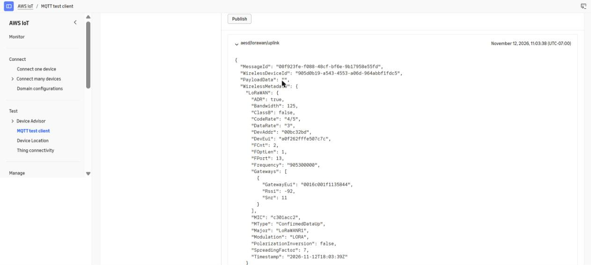

# Issue #4: Basics Station on the Pi, connected to AWS IoT Core for LoRaWAN

Results for the five "definition of done" items of issue #4, measured on the Pi 5 with the image built from commit `a611da7` (`sdcard.img` SHA-256 `793aac4c…00a6`, written to the card from the PC and verified by read-back).

<!-- This file was partially generated using Claude Code using the chat session at:
     Link to chat session (issue #4): TODO(issue-4-session-link) -->

- Gateway: Pi 5 with the Seeed WM1302 Pi HAT (SX1302, US915), Ethernet only. No Wi-Fi file was provisioned, so `wlan0` stays down.
- Gateway EUI: `0016C001F1135844`, the SX1302's EUI.
- Network server: AWS IoT Core for LoRaWAN, `us-east-1`, gateway ID `92f4b2e8-b047-46a1-859b-b15ad06d79a2`, RfRegion `US915`.
- In the logs here, the account-specific host IDs of the CUPS and LNS endpoints are replaced by `<id>`, and the certificate detail dumps that Station prints are removed. No certificate or key content appears anywhere.

## 1. The package builds, and `station --version` runs on the Pi

`base_external/package/basicstation/` builds Basics Station v2.0.6 for the `corecell` platform, `std` variant. The complete `make basicstation` log is [logs/issue4-basicstation-build.log](logs/issue4-basicstation-build.log). It shows the three hash checks (Station, sx1302_hal V2.1.0, mbedtls 2.28.10), Station's libloragw patch being applied, and the last lines:

```
 [arm-linux-gnueabihf] CC   ../bin/station
 platform=corecell variant=std STATION EXE built
>>> basicstation v2.0.6 Installing to target
/usr/bin/install -D -m 0755 <repo>/buildroot/output/build/basicstation-v2.0.6/build-corecell-std/bin/station <repo>/buildroot/output/target/usr/bin/station
```

`arm-linux-gnueabihf` is only upstream's label for the corecell platform. The compiler is Buildroot's `aarch64-linux-gcc`, and the binary is an aarch64 executable that needs only `libc` and `libm`.

On the Pi:

```
# station --version
Station: 2.0.6(corecell/std) 2026-11-12 16:50:47
Package: (null)
# cd /etc/station && station --version | tail -n 1
Package: 2.0.6
```

The package version is read from `version.txt` in the home directory, so it is only shown when Station runs with `/etc/station` as its home, as `S60station` runs it.

## 2. The gateway is registered in AWS and shows Connected

The gateway was added to AWS IoT Core for LoRaWAN with EUI `0016C001F1135844` and RfRegion `US915` ([aws-iot-core-setup.md](aws-iot-core-setup.md) has the steps). Its certificate, key, trust certificate and CUPS endpoint went onto the boot partition as `cups.crt`, `cups.key`, `cups.trust` and `cups.uri`.

First boot of the flashed card, from [logs/issue4-first-boot-syslog.log](logs/issue4-first-boot-syslog.log):

```
17:11:22 provision: installed /etc/station/cups.uri            (and cups.trust, cups.crt, cups.key)
17:11:24 station: gateway EUI 0016c001f1135844, starting when the clock is set
17:11:26 ifplugd.action: eth0 link up, uptime 7.30 s: ifup
17:11:32 ntp-hook: eth0 has a DHCP lease, uptime 13.58 s
17:11:42 ntp-hook: clock synchronised by NTP, uptime 23.59 s
17:11:44 station: starting /usr/bin/station, uptime 24.82 s
```

Station then fetched the LNS address and credentials from CUPS and connected, from [logs/issue4-first-boot-station.log](logs/issue4-first-boot-station.log):

```
17:11:44.420 [CUP:INFO] Connecting to CUPS ... https://<id>.cups.lorawan.us-east-1.amazonaws.com:443 (try #1)
17:11:50.596 [CUP:INFO] [Segment] TC URI: wss://<id>.lns.lorawan.us-east-1.amazonaws.com:443
17:11:50.596 [CUP:INFO] [Segment] TC Credentials update completed (3228 bytes)
17:11:50.620 [TCE:INFO] Connecting to INFOS: wss://<id>.lns.lorawan.us-east-1.amazonaws.com:443
17:11:51.083 [TCE:INFO] Infos: 0016:c001:f113:5844 0016:c001:f113:5844 wss://<id>.lns.lorawan.us-east-1.amazonaws.com:443/gateway/0016c001f1135844
17:11:54.025 [RAL:INFO] Concentrator started (2s363ms)
17:11:54.025 [S2E:INFO] Configuring for region: US915 -- 902.0MHz..928.0MHz
```

So the gateway was connected, with the concentrator running on the channel plan AWS sent, about 34 s after power-on. `/etc/station` then holds the four `cups.*` files (mode 0600), the `tc.*` files Station saved (mode 0640, in a 0700 directory), `station.conf` and `version.txt`. Nothing is left on the boot partition.

AWS reports the same. `aws iotwireless get-wireless-gateway-statistics` 23 s later:

```
UTC now: 2026-11-12 17:12:17
gateway 92f4b2e8-b047-46a1-859b-b15ad06d79a2 (EUI 0016c001f1135844): ConnectionStatus=Connected LastUplinkReceivedAt=2026-11-12T17:11:51.436146234Z
```

## 3. An uplink from a node, with this gateway in its metadata

The node is a SoilData V2 board on the bench next to the gateway, registered in AWS as `aesd-test-node` (DevEUI `A0F262FFFE507C7C`, LoRaWAN 1.1 OTAA, a service profile with gateway metadata on, destination `aesd_uplinks`, which publishes to the MQTT topic `aesd/lorawan/uplink`). Its keys were generated and written to the board outside this work and are not in this repo.

The gateway received its join request, sent the join-accept that AWS answered with, and then received its first data uplink ([logs/issue4-uplink-station.log](logs/issue4-uplink-station.log), Station at log level VERBOSE):

```
17:59:51.142 [S2E:VERB] RX 903.9MHz DR0 SF10/BW125 snr=11.8 rssi=-84 ... - jreq MHdr=00 JoinEUI=::0 DevEUI=a0f2:62ff:fe50:7c7c DevNonce=1
17:59:56.132 [S2E:INFO] TX ::1 diid=24707 [ant#0] - dntxed: 923.3MHz 26.0dBm ant#0(0) DR10 SF10/BW500 ... (33 bytes)
18:00:24.988 [S2E:VERB] RX 905.3MHz DR0 SF10/BW125 snr=10.0 rssi=-84 ... - updf mhdr=80 DevAddr=00BC32BD FCtrl=82 FCnt=0 FOpts=[7D4F] 0D ... (15 bytes)
18:00:25.982 [S2E:INFO] TX ::1 diid=20186 [ant#0] - dntxed: 927.5MHz 26.0dBm ant#0(0) DR10 SF10/BW500 ... (19 bytes)
```

AWS recorded that uplink with this gateway, and only this gateway, in its metadata. `aws iotwireless get-wireless-device-statistics` ([logs/issue4-uplink-aws-statistics.json](logs/issue4-uplink-aws-statistics.json)):

```json
"LastUplinkReceivedAt": "2026-11-12T18:00:25.222644404Z",
"LoRaWAN": {
    "DevEui": "a0f262fffe507c7c", "FPort": 13, "DataRate": 0, "Frequency": 905300000,
    "Gateways": [ { "GatewayEui": "0016c001f1135844", "Snr": 10.0, "Rssi": -84.0 } ]
}
```

The RSSI and SNR match what the gateway logged for the same frame (-84 dBm, 10.0 dB at 905.3 MHz, SF10).

A second uplink followed at 18:01:14.557 (905.3 MHz, now SF7 after the network's data-rate command, RSSI -82 dBm, SNR 9.8 dB at the gateway). AWS recorded it at 18:01:14.787 through the same gateway with RSSI -82 and SNR 9.75.

**MQTT test client.** With the AWS IoT MQTT test client subscribed to `aesd/lorawan/uplink`, the node sent a third uplink. The message lists this gateway in `WirelessMetadata.LoRaWAN.Gateways`:



| | MQTT message (screenshot) | Gateway log |
|---|---|---|
| Time | `"Timestamp": "2026-11-12T18:03:39Z"` | `18:03:39.190 ... RX 905.3MHz DR3 SF7/BW125` |
| Device | `"DevEui": "a0f262fffe507c7c"`, `"DevAddr": "00bc32bd"`, `"FCnt": 2`, `"FPort": 13` | `updf mhdr=80 DevAddr=00BC32BD ... FCnt=2` |
| Gateway | `"GatewayEui": "0016c001f1135844"`, `"Rssi": -92`, `"Snr": 11` | `snr=11.0 rssi=-92` |
| MIC | `"MIC": "c301acc2"` | `mic=-1028914749`, which is 0xC2AC01C3, the same four bytes in transmit order |

So the frame in the test client is the frame this gateway received and forwarded, and no other gateway heard it. `PayloadData` is empty because the node's link test sends a confirmed frame with no payload.

The node sends on request, not on a schedule, and transmits at 0 dBm because this board's radio fails at higher power. That is a fault of the node, so the RSSI here says nothing about the gateway's range.

## 4. Station starts at boot and reconnects after the Ethernet cable is pulled

**Start at boot.** `/etc/init.d/S60station` started Station on the first boot of the flashed card with no manual step (section 2): `station: starting /usr/bin/station, uptime 24.82 s`, then two processes, `station --daemon --home /etc/station` (the daemon and its worker). With no `cups.uri` or `tc.uri` in `/etc/station` the script logs `no cups.uri or tc.uri in /etc/station, not starting` and exits 0.

**How eth0 is handled.** BusyBox `ifplugd` (`S41ifplugd`) runs `ifdown eth0` 2 s after the link goes down and `ifup eth0` when it comes back. Before this issue `eth0` was configured once at boot. It did keep asking for a lease in the background, so a cable plugged in late still got an address, but an unplugged cable left the old address and default route in place.

**Cable pull.** The Ethernet cable was pulled out of the Pi by hand for 4 min 14 s and plugged back in. The Pi stayed powered. For this run Station had been restarted with `STATION_LOGLEVEL=VERBOSE` (same binary and `station.conf`), so the log has the `Connected to MUXS` lines. From [logs/issue4-cable-pull-syslog.log](logs/issue4-cable-pull-syslog.log) and [logs/issue4-cable-pull-station.log](logs/issue4-cable-pull-station.log):

| UTC | Event | After link-up |
|---|---|---|
| 17:18:58 | `eth0: Link is Down` (cable out) | |
| 17:19:01 | `ifplugd.action: eth0 link down ... ifdown` | |
| 17:20:44.6 | Station: `Recv failed`, `Connection to MUXS closed`. It retries every 10, 20, 30, 40, 50 s; each try fails at once with `Failed to get an IP address for the given hostname` | |
| 17:23:12 | `eth0: Link is Up` (cable in), `ifplugd.action: eth0 link up ... ifup` | 0 s |
| 17:23:15.6 | Station's next try, 3 s before the lease: fails, `INFOS reconnect backoff 60s (retry 6)` | 3 s |
| 17:23:18 | `ntp-hook: eth0 has a DHCP lease` | 6 s |
| 17:24:15.6 | `Connecting to INFOS` | 63 s |
| 17:24:16.2 | `Connected to MUXS.` | **64 s** |
| 17:24:18.8 | `Concentrator started`, `Configuring for region: US915` | 67 s |

So the gateway was connected again 64 s after the cable went back in, inside the 2-minute limit. AWS agreed: `ConnectionStatus=Connected`, `LastUplinkReceivedAt=2026-11-12T17:24:16Z`.

Almost all of that time is Station's retry timer, not the network: the lease took 6 s. Station waits 10 s times the retry count between tries, 60 s at most, so this run was close to the worst case for an outage of a few minutes (a try just before the lease, then the full 60 s).

**Short loss (simulated).** `eth0` was taken down for 30 s by stopping `ifplugd` on the Pi, which runs the same `ifdown`, and started again ([logs/issue4-outage-30s-syslog.log](logs/issue4-outage-30s-syslog.log)). The lease was back 7.5 s after link-up with the same address. Station logged nothing: its TLS connection to the LNS survived, and AWS showed the gateway Connected throughout. This was not a cable pull.

**Long loss (simulated).** The same way, `eth0` was taken down for 12 minutes ([logs/issue4-outage-12min-syslog.log](logs/issue4-outage-12min-syslog.log), [logs/issue4-outage-12min-station.log](logs/issue4-outage-12min-station.log)). This reaches a path the 4-minute cable pull did not: after its ninth failed try Station logged `Router rejected or retry limit reached. Invoking CUPS`, and from then on it tried CUPS once a minute and the LNS with the same 10 to 60 s back-off, both failing while the network was down.

| UTC | Event | After link-up |
|---|---|---|
| 17:29:11 | `ifplugd.action: eth0 link down ... ifdown` | |
| 17:30:24 | Station: `Recv failed`, `Connection to MUXS closed` | |
| 17:36:54 | `Router rejected or retry limit reached. Invoking CUPS.` | |
| 17:41:15 | `ifplugd.action: eth0 link up ... ifup` | 0 s |
| 17:41:21 | `ntp-hook: eth0 has a DHCP lease` | 6 s |
| 17:41:24.8 | `Connected to MUXS.` | **10 s** |
| 17:41:27.4 | `Concentrator started` | 12 s |

Here the next LNS try happened to fall 3 s after the lease. With the timers above, the wait after the lease is between 0 and 60 s, whatever the length of the outage, so the reconnect stays under about 70 s after the cable is back.

## 5. No certificates or keys in the repo

The check from the issue, `git grep -l` for the PEM private-key header line, prints nothing and exits 1 (no match) on this branch. The pattern itself is not written out here, because this file would then match it.

`.gitignore` (issue #5) excludes `cups.*`, `tc.*`, `*.pem`, `*.key`, `*.crt` and `*.trust`. The gateway's files were created by the AWS CLI straight into a folder outside the repo, copied to the boot partition, and moved into `/etc/station` by `S35provision`. On the Pi they were only ever listed by name, size and mode.
